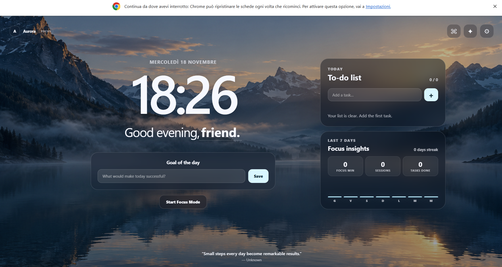
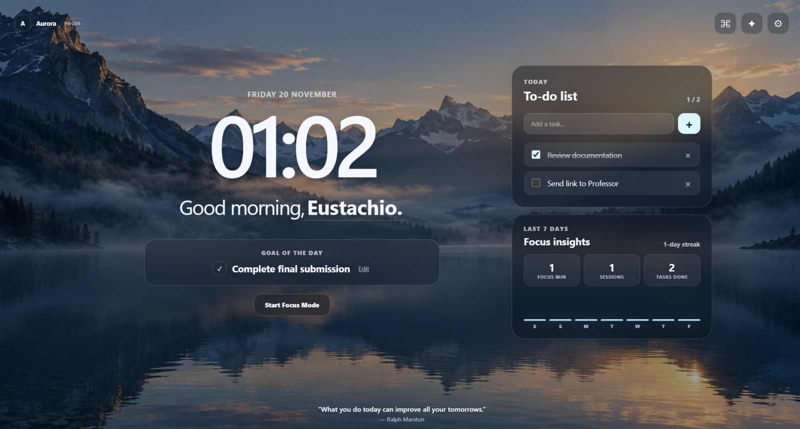
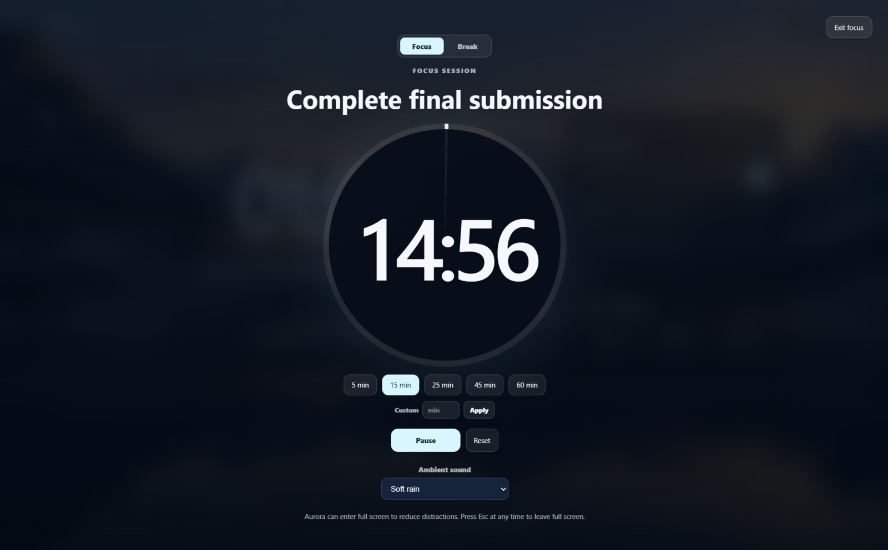
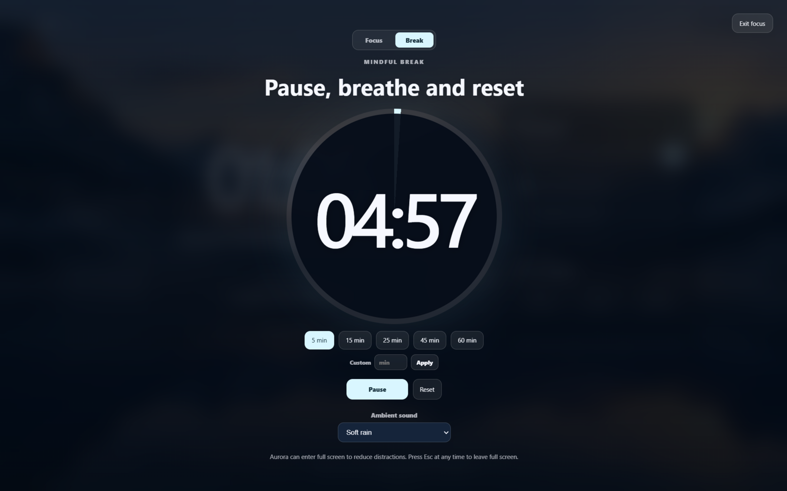
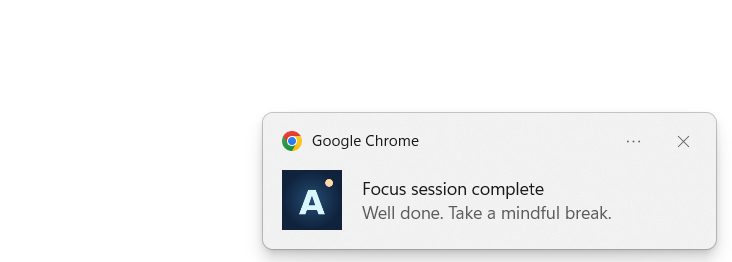
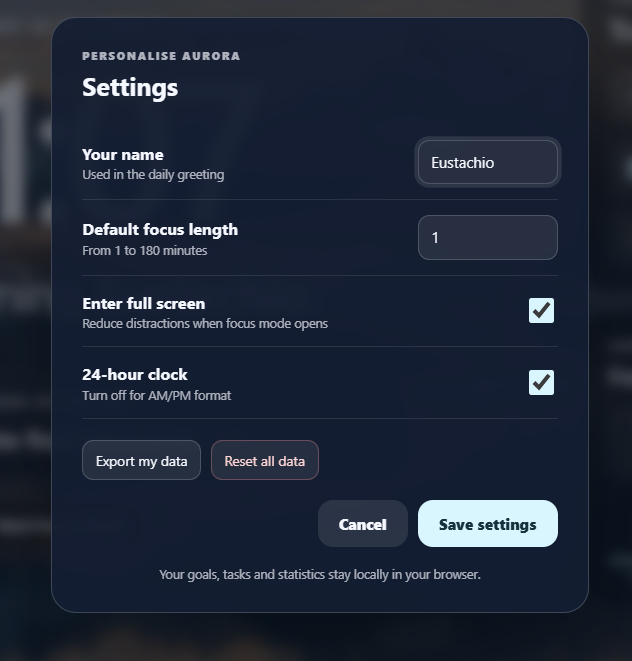
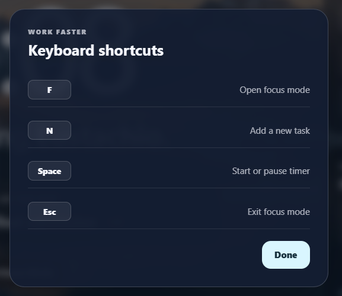
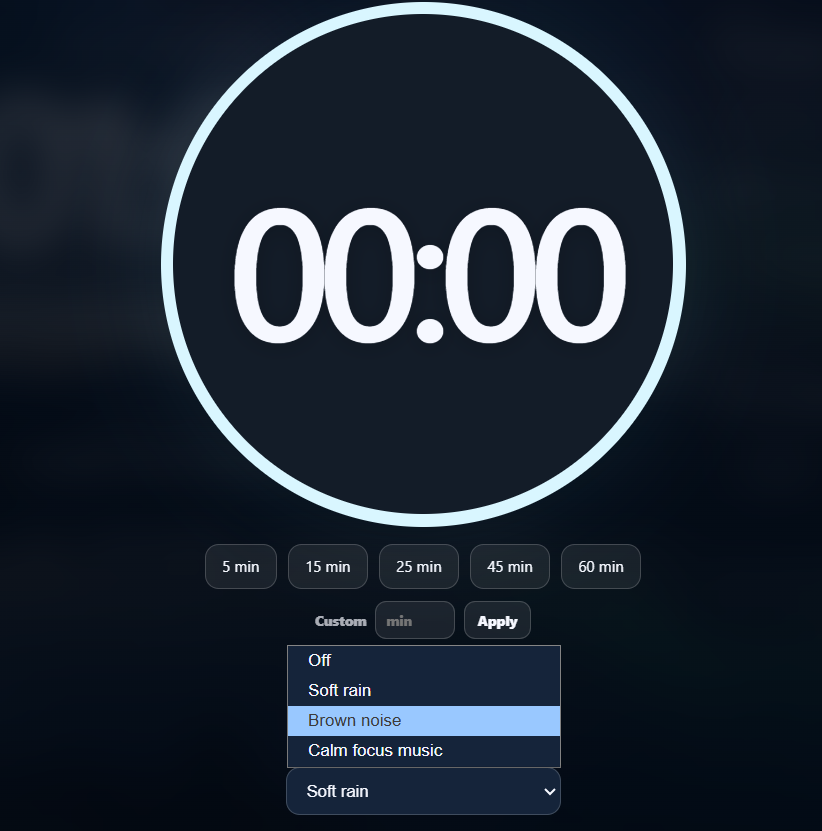

# Aurora Focus — Chrome Extension

Aurora Focus is a Manifest V3 Chrome extension that replaces Chrome's new tab page with a private productivity dashboard, as Momentum does. It combines a daily goal, editable tasks, focus/break timers, ambient sound and seven-day insights without an account or external server.



## Purpose

The project reinterprets the Momentum dashboard as a practical focus tool. Its goal is to reduce friction between planning and starting work while keeping the user's personal productivity data private.

## Main features

- daily goal and persistent editable to-do list;
- focus and break modes with presets or a custom duration;
- Chrome alarms and completion notifications;
- timer restoration after the dashboard is closed and reopened;
- soft rain, brown noise and generated focus audio;
- optional full-screen focus view and keyboard shortcuts;
- seven-day focus minutes, completed-task count and activity streak;
- settings for name, 12/24-hour clock, timer defaults and full screen;
- local JSON data export and deletion;
- three bundled backgrounds and first-run onboarding.

## Data collection

**Not applicable:** Aurora does not scrape websites, call an external API or collect analytics. The only data created is information the user deliberately enters or generates while using the extension: name, daily goal, tasks, settings and completed focus sessions.

## Data persistence

- `localStorage` stores goals, tasks, settings, statistics and onboarding state inside the extension origin.
- `chrome.storage.local` stores the active timer record used by the background service worker.
- `chrome.alarms` preserves the completion event while the dashboard is not in the foreground.
- Export creates a local JSON file selected by the user.

No data is transmitted to a custom server. The Settings panel lets the user export or delete the stored information.

## User interaction

Aurora appears every time the user opens a new tab (it can also be opened from the toolbar icon). The user saves a goal, manages tasks and starts a focus or break session. The dashboard updates its insights when sessions and tasks are completed. The sparkle button cycles backgrounds; Settings controls personal preferences and data management.

Keyboard shortcuts:

- `F` — open Focus Mode;
- `N` — focus the new-task field;
- `Space` — start or pause an open timer;
- `Esc` — leave full screen.

## Feature demonstration

The following screenshots were captured during the final manual verification.

| Task workflow | Focus session |
|---|---|
|  |  |
| A task can be added and completed; the seven-day insights update immediately. | Focus Mode provides presets, a custom duration, pause/reset controls and optional ambient sound. |

| Break session | Completion notification |
|---|---|
|  |  |
| Break Mode uses the same persistent timer controls with a distinct mindful-break state. | The background service worker and Chrome alarm produce a completion notification even when attention is elsewhere. |

| Settings and local data | Keyboard controls |
|---|---|
|  |  |
| Settings cover the name, default focus length, full-screen preference, clock format, JSON export and local-data reset. | The dashboard documents shortcuts for opening Focus Mode, creating a task, controlling the timer and leaving focus view. |

| Ambient audio choices |
|---|
|  |
| A session can run silently or with soft rain, brown noise or generated calm focus music. |

## Setup

Requirements: desktop Google Chrome or another Chromium browser that supports unpacked Manifest V3 extensions. No Node.js, Python, account or API key is needed.

1. Download or clone this repository.
2. Open `chrome://extensions`.
3. Enable **Developer mode** in the top-right corner.
4. Select **Load unpacked**.
5. Choose the `01-chrome-extension` folder — the folder that directly contains `manifest.json`.
6. Open a new tab (`Ctrl+T` / `Cmd+T`). Chrome may ask whether to keep the new tab page changed by the extension: choose **Keep it**.
7. Optionally pin **Aurora Focus** from Chrome's Extensions menu; its toolbar icon also opens the dashboard.

After changing source files, return to `chrome://extensions` and click the extension's **Reload** button.

## Project structure

| File/folder | Responsibility |
|---|---|
| `manifest.json` | Manifest V3 metadata, new tab override, permissions, service worker and icons |
| `background.js` | Toolbar action, alarms and Chrome notifications |
| `dashboard.html` | Semantic interface and dialogs |
| `dashboard.js` | Goals, tasks, timer, insights, settings, audio and export |
| `styles.css` | Responsive design, themes and reduced-motion rules |
| `backgrounds/` | Three bundled background images |
| `icons/` | Extension and notification icons |

## Validation

```bash
node --check dashboard.js
node --check background.js
python -m json.tool manifest.json
```

Manual acceptance checklist:

- load the unpacked extension without manifest errors and confirm that a new tab shows Aurora;
- save/edit a goal and add/edit/complete/delete a task;
- start, pause, resume and reset focus and break timers;
- close the dashboard during a short timer and confirm the notification;
- reload and confirm that settings and timer state persist;
- export data and verify the downloaded JSON;
- test keyboard operation and a narrow window.

## Learning

This project taught me how a browser extension differs from a normal website: it needs a manifest, explicit permissions and a background service worker. I also learned to coordinate page state with Chrome alarms, model persistent timer state from an end timestamp, use local-first storage deliberately, and design keyboard-accessible interactions without adding unnecessary permissions.

### Challenge and how I approached it

The hardest part was the timer. A countdown that only runs inside the page stops as soon as the dashboard tab is closed, so a focus session could silently never finish. I changed the model: when a session starts, the dashboard stores its end time, and the background service worker schedules a `chrome.alarms` alarm for that moment and shows the notification. When the dashboard is reopened, it rebuilds the remaining time from the stored end timestamp instead of trusting a counter. I tested it by closing the dashboard during a short session and waiting for the notification.

## Limitations and assistance

Limitations:

- data is local to one browser profile and is not synchronized across devices;
- clearing extension/browser storage deletes information unless it was exported;
- Chrome controls notification delivery and always allows the user to exit full screen;
- the extension is loaded unpacked for assessment and is not published in the Chrome Web Store;
- automated browser-extension end-to-end tests are not included, so Chrome-specific flows require the manual checklist above.

Assets: the three background images in `backgrounds/` are my own photos. The quotes are short attributed citations.

No tutorials or external code were used in this project beyond the AI assistance described here.

AI assistance (ChatGPT/Codex) was used for iterative brainstorming, debugging suggestions, code review and documentation structure. I made the product decisions, executed the setup and Git commands, reviewed the generated suggestions, and manually verified the extension. See [`AUDIT.md`](AUDIT.md) for what the audit found and how I fixed it.

## Privacy and permissions

Aurora requests only `storage`, `alarms` and `notifications`. It contains no analytics, remote scripts, advertising or login. The complete technical rationale is in [`PROJECT_REPORT.md`](PROJECT_REPORT.md).
