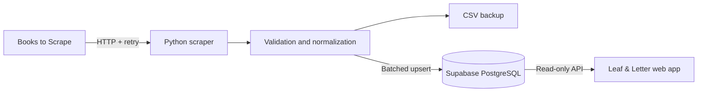

# Books Pipeline & Leaf & Letter

An end-to-end data engineering project that extracts all 1,000 products from [Books to Scrape](https://books.toscrape.com/), validates and normalizes the records, synchronizes them with Supabase PostgreSQL, and presents them in a responsive catalogue.

The project goes beyond a one-off scraper: it includes retry logic, atomic CSV backups, idempotent database upserts, connection tests, Row Level Security, automated parsing tests, and a live browser interface.

## Architecture



## Highlights

### Data pipeline

- crawls all catalogue pages and detail pages;
- extracts 14 normalized fields per book;
- retries temporary HTTP failures with exponential backoff;
- supports polite request delays, timeouts, limits, and strict mode;
- records skipped URLs without losing the complete run;
- writes CSV backups atomically;
- upserts in configurable batches using the UPC as primary key;
- verifies the resulting database count.

### Web application

- live Supabase data and connection status;
- title, category, rating, and price filters;
- sorting and server-side pagination;
- collection statistics and last synchronization date;
- automatic 1,000-book fallback if Supabase or the network is unavailable;
- saved books persisted in local storage;
- shareable filter URLs;
- random “Surprise me” discovery;
- accessible book details and original source links;
- responsive layout for desktop, tablet, and mobile.

### Security and quality

- the Supabase secret key is read only from a local `.env`;
- the browser uses a publishable key protected by read-only RLS;
- `.env`, virtual environments, cache, and generated data are ignored;
- parser behavior is tested against deterministic HTML fixtures;
- SQL constraints protect prices, ratings, review counts, and stock.

## Repository structure

```text
.
├── pipeline.py              # Complete scrape-to-database workflow
├── scraper.py               # Extraction, parsing, retry, CSV backup
├── supabase_client.py       # Safe connection and batched upsert
├── test_connection.py       # Temporary write/read/delete smoke test
├── schema.sql               # PostgreSQL schema, constraints and indexes
├── tests/
│   └── test_scraper.py      # Unit tests with offline HTML fixtures
├── web/
│   ├── index.html           # Leaf & Letter interface
│   ├── styles.css
│   ├── app.js
│   ├── config.js            # Browser-safe publishable key only
│   ├── data/                 # Complete static resilience snapshot
│   └── frontend_access.sql  # Public read-only RLS policy
├── .env.example
└── requirements.txt
```

## Data model

| Field | Description |
|---|---|
| `book_id` | UPC and primary key |
| `title`, `category` | Catalogue classification |
| `price_gbp` | Displayed price |
| `price_excl_tax_gbp`, `price_incl_tax_gbp`, `tax_gbp` | Product-table prices |
| `availability`, `stock_quantity` | Stock information |
| `rating`, `review_count` | Rating metadata |
| `description` | Product description |
| `product_url`, `image_url` | Source and cover links |
| `scraped_at` | UTC collection timestamp |

## Quick start

### 1. Create the Python environment

Windows PowerShell:

```powershell
py -m venv .venv
.\.venv\Scripts\Activate.ps1
py -m pip install -r requirements.txt
```

macOS/Linux:

```bash
python3 -m venv .venv
source .venv/bin/activate
python -m pip install -r requirements.txt
```

### 2. Run the offline tests

```powershell
py -m unittest discover -s tests -v
```

### 3. Test the scraper without Supabase

```powershell
py scraper.py --limit 10
```

Inspect the generated `books.csv`. Run `py scraper.py` without a limit to collect the complete catalogue.

### 4. Configure Supabase

1. Create a Supabase project.
2. Open **SQL Editor**, paste `schema.sql`, and run it.
3. Copy `.env.example` to `.env`.
4. Add the project URL and server-side secret key:

```dotenv
SUPABASE_URL=https://YOUR_PROJECT_ID.supabase.co
SUPABASE_SECRET_KEY=sb_secret_YOUR_SECRET_KEY
```

Never commit `.env` or put this secret key in the frontend.

### 5. Test database access

```powershell
py test_connection.py
```

The script writes one temporary row, reads it back, and deletes it.

### 6. Run the full pipeline

First use a small safe run:

```powershell
py pipeline.py --limit 10
```

Then synchronize all 1,000 books:

```powershell
py pipeline.py
```

Running the pipeline again updates existing rows rather than creating duplicates.

## Web app setup

1. Run `web/frontend_access.sql` in Supabase to create a public **read-only** policy.
2. Put the Project URL and **publishable** key in `web/config.js`.
3. Serve the folder locally:

```powershell
py -m http.server 5500 --directory web
```

4. Open [http://localhost:5500](http://localhost:5500).

The publishable key is intended for browser use. Database safety comes from RLS: anonymous visitors can select books but cannot insert, update, or delete them.

## Useful pipeline options

```text
--limit 10       Process a small sample
--delay 0.25     Change the polite delay between requests
--timeout 30     Change the HTTP timeout
--batch-size 50  Change Supabase upsert batch size
--skip-csv       Skip the local backup
--strict         Stop on the first failed product
```

## Responsible use

Books to Scrape is explicitly provided as a scraping sandbox. For any other website, review its terms, robots rules, rate limits, and applicable data-protection requirements before collecting data.

## Author

Eustachio Santeramo

