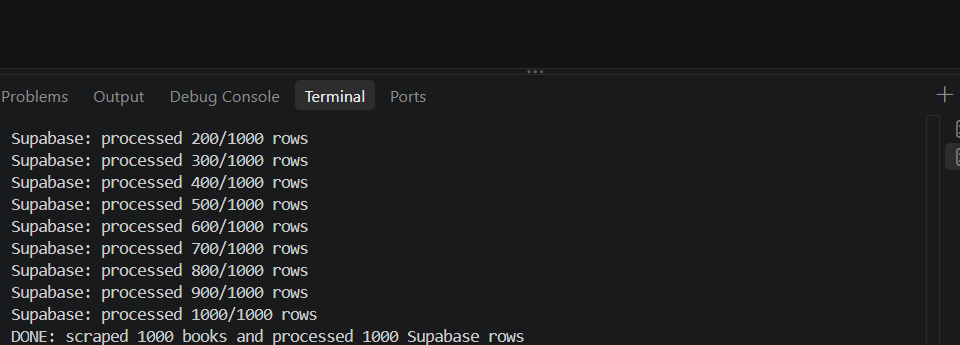
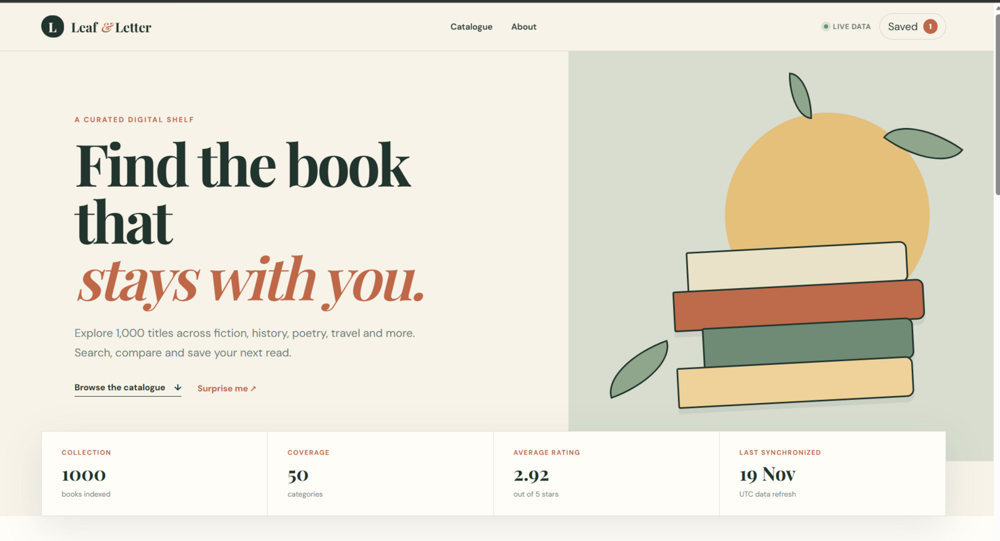
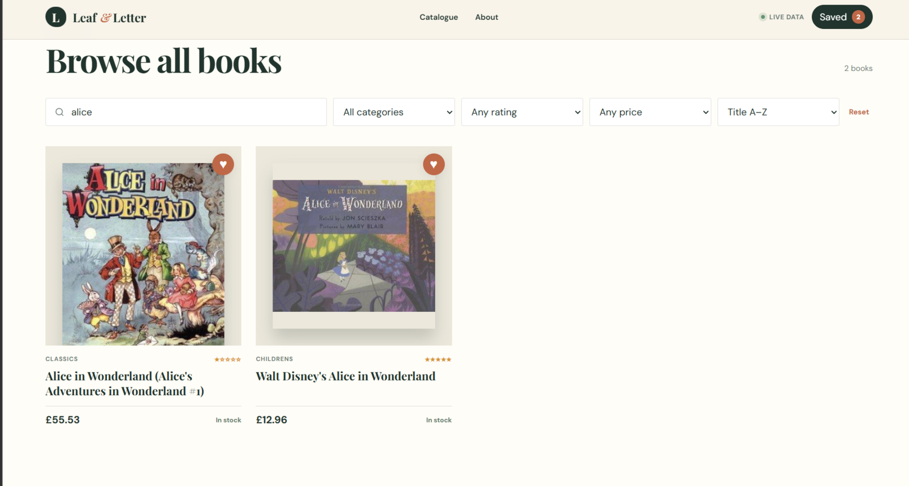
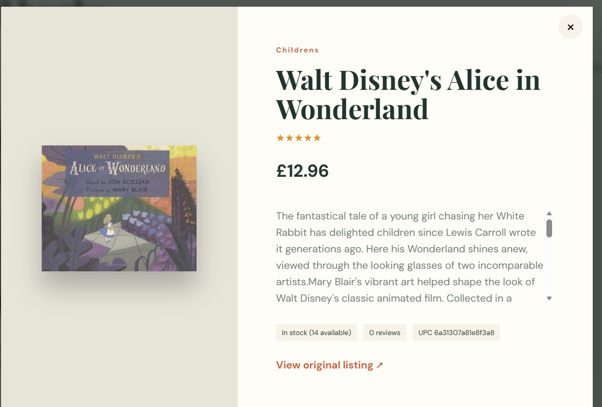
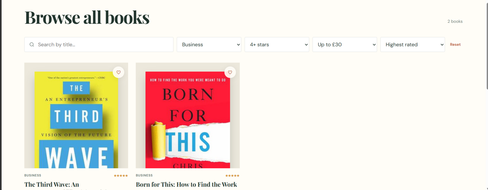
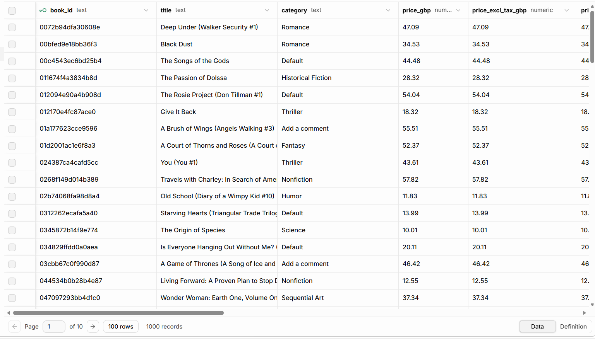
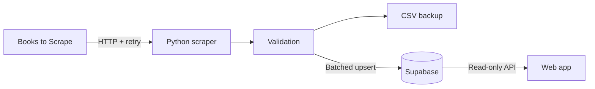

# Books Pipeline & Leaf & Letter

An end-to-end project that extracts all 1,000 products from [Books to Scrape](https://books.toscrape.com/), validates and normalizes the records, saves a CSV backup, synchronizes them with Supabase PostgreSQL and presents them in an interactive catalogue.



## Purpose

The goal was to build a complete, reproducible data flow rather than a one-off scraper: acquire source data responsibly, turn inconsistent HTML into typed records, persist the result safely, and give a user meaningful ways to browse the collection.

## Data collection

`scraper.py` visits every catalogue page and then each product detail page. It extracts 14 fields per book: UPC, title, category, prices, availability, stock quantity, rating, review count, description, product URL, image URL and collection timestamp.

The collector uses a reusable HTTP session, timeout, retry/backoff and a configurable polite delay. It validates required values and can either report skipped products or stop immediately with `--strict`. Books to Scrape is explicitly designed as a scraping sandbox; the same approach should not be applied to another site without checking its terms, robots rules and rate limits.

## Data persistence and how data is saved

The project saves data in three deliberate layers:

1. **CSV backup:** `books.csv` is first written to a temporary file and then atomically renamed, reducing the risk of a half-written export.
2. **Supabase PostgreSQL:** `pipeline.py` sends validated records in batches. The UPC is the `book_id` primary key and upsert conflict key, so re-running the pipeline updates records instead of duplicating them.
3. **Browser resilience snapshot:** `web/data/books-fallback.json` contains the complete catalogue so the interface remains demonstrable if Supabase is paused or unavailable. Saved-book IDs are stored separately in browser `localStorage`.

`schema.sql` adds types, constraints and indexes. Row Level Security lets anonymous browser users read books but not insert, update or delete them. Only the Python pipeline receives the server-side secret through a local `.env` file.

## User interaction

Leaf & Letter lets a user search by title, filter by category/rating/price, change sorting, paginate, open accessible book details, save favourites, share filter URLs and request a random recommendation. It displays collection metrics and whether data came from live Supabase or the fallback snapshot.

## Feature demonstration

The pipeline screenshot above records the completed 1,000-book synchronization. The following screenshots demonstrate the live catalogue and its main user flows.

| Live catalogue | Search and saved books |
|---|---|
|  |  |
| The homepage reports live Supabase data, 1,000 indexed books, 50 categories, the average rating and last synchronization date. | Title search narrows the catalogue, while heart controls save books locally and the Saved counter reflects the selection. |

| Complete book details | Random recommendation |
|---|---|
|  |  |
| The accessible detail view combines the cover, category, rating, price, description, availability, reviews, UPC and original listing. | **Surprise me** selects a random catalogue record and opens its complete detail view. |

| Combined filters and sorting | Pagination |
|---|---|
|  |  |
| Category, minimum rating, price ceiling and sort order can be combined in one query. | Previous/Next navigation exposes the full collection without rendering all 1,000 cards at once. |

| Supabase persistence |
|---|
|  |
| The PostgreSQL table contains 1,000 normalized records with stable book IDs, titles, categories and typed price fields. |

## Architecture



## Setup

Requirements: Python 3.10+, internet access for scraping, and a Supabase project only if the cloud pipeline is being tested. The frontend can run from its included fallback without Supabase.

### 1. Create the Python environment

Run every command in this guide from the project folder:

```bash
cd 02-books-scraper-supabase
```

Windows PowerShell:

```powershell
py -m venv .venv
.\.venv\Scripts\Activate.ps1
py -m pip install -r requirements.txt
```

macOS/Linux:

```bash
python3 -m venv .venv
source .venv/bin/activate
python -m pip install -r requirements.txt
```

### 2. Run tests and a small scrape

```powershell
py -m unittest discover -s tests -v
py scraper.py --limit 10
```

The second command creates a local `books.csv`. Remove `--limit 10` to collect the full catalogue.

### 3. Configure Supabase

1. Create or resume a Supabase project.
2. In **SQL Editor**, run `schema.sql`.
3. Copy `.env.example` to a new file named `.env`.
4. Replace only the placeholders in `.env`:

```dotenv
SUPABASE_URL=https://YOUR_PROJECT_ID.supabase.co
SUPABASE_SECRET_KEY=sb_secret_YOUR_SECRET_KEY
```

Never commit `.env`, paste the secret into `web/config.js`, or show it in screenshots.

### 4. Verify and run the pipeline

```powershell
py test_connection.py
py pipeline.py --limit 10
py pipeline.py
```

`test_connection.py` creates, reads and deletes one temporary row. The final command processes all 1,000 books. A repeated run performs idempotent updates.

To refresh the browser fallback snapshot from the same run, add `--export-json`:

```powershell
py pipeline.py --export-json web/data/books-fallback.json
```

`scraper.py --export-json web/data/books-fallback.json` does the same without Supabase.

### 5. Run the web app

For an offline/fallback demonstration, simply serve `web`:

```powershell
py -m http.server 5500 --directory web
```

Open [http://localhost:5500](http://localhost:5500), and stop the server with `Ctrl+C`.

For live Supabase data, first run `web/frontend_access.sql`, then set the project URL and a **publishable browser key** in `web/config.js`. The publishable key is not the server secret; RLS is what makes its access read-only.

## Useful pipeline options

| Option | Effect |
|---|---|
| `--limit 10` | Process a small sample |
| `--delay 0.25` | Set the polite delay between requests |
| `--timeout 30` | Set the HTTP timeout |
| `--batch-size 50` | Set Supabase upsert batch size |
| `--skip-csv` | Skip the local CSV backup |
| `--export-json PATH` | Also write the web fallback snapshot |
| `--strict` | Stop on the first failed product |

## Testing

The offline unit tests cover price normalization, stock parsing, deterministic HTML parsing, invalid configuration, CSV output and the JSON fallback export. `test_connection.py` is a separate cloud smoke test. During the final audit, the complete unit suite passed (5 tests, 0 failures), the live Supabase write/read/delete check passed, and a 10-book pipeline sample completed with 10 successful synchronizations and no failures.

## Learning

I learned that scraping is not only selecting HTML elements: a reliable pipeline needs retries, rate awareness, normalization, stable identifiers and explicit failure handling. I also learned why idempotent upserts matter, how database constraints complement Python validation, how RLS separates a browser-safe read path from a private write path, and why an independent local backup makes a cloud-dependent project more reproducible.

### Challenge and how I approached it

The main challenge was letting a public web page read the database without exposing a key that can change it. The Python pipeline needs to write, the browser only needs to read, and anything placed in `web/config.js` is visible to every visitor. I split the two paths: the server secret lives only in the ignored `.env` and is used by `pipeline.py`, while the browser uses Supabase's publishable key. On its own that key would not be safe, so I enabled Row Level Security and added `frontend_access.sql`, which grants anonymous users `SELECT` only. I verified the result by checking that the catalogue loads live data while write operations remain reserved to the server role.

## Limitations and assistance

Limitations:

- the scraper depends on the source HTML structure and selectors may break if the site changes;
- the source is a training catalogue and omits fields such as author and publication date;
- the source itself files some books under the categories "Default" (152 books) and "Add a comment" (67 books); these are real source values, kept as collected rather than guessed;
- a full scrape makes about 1,050 requests and therefore takes time;
- Supabase free projects may pause after inactivity and must be resumed before a live demo;
- live execution depends on network access and valid project credentials;
- the fallback snapshot is static until the pipeline is run again with `--export-json`;
- there is no production scheduler, monitoring or incremental change detection.

AI assistance (ChatGPT/Codex) was used to explain setup steps, review architecture, suggest defensive improvements and organize documentation. I executed the pipeline and database operations, inspected results, made the implementation decisions, and reviewed the final code. See [`AUDIT.md`](AUDIT.md) for the documented audit.

## Repository structure

```text
.
├── pipeline.py              # Complete scrape-to-database workflow
├── scraper.py               # Extraction, parsing, retry and CSV backup
├── supabase_client.py       # Safe connection and batched upsert
├── test_connection.py       # Temporary write/read/delete smoke test
├── schema.sql               # Schema, constraints and indexes
├── tests/test_scraper.py    # Offline unit tests
├── web/                     # Leaf & Letter frontend and fallback data
├── .env.example             # Placeholders only
└── requirements.txt         # Reproducible Python dependencies
```

More engineering detail is available in [`PROJECT_REPORT.md`](PROJECT_REPORT.md).
