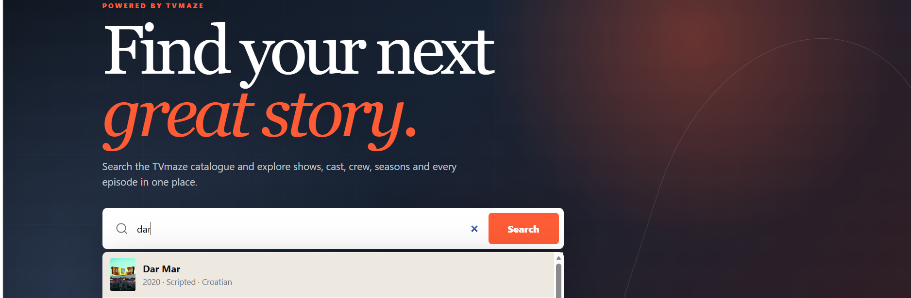
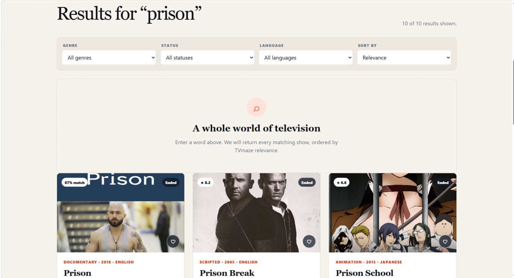
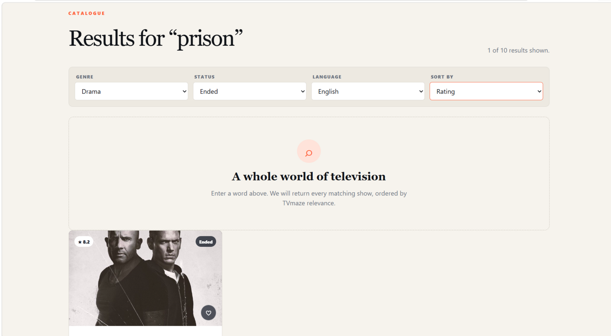
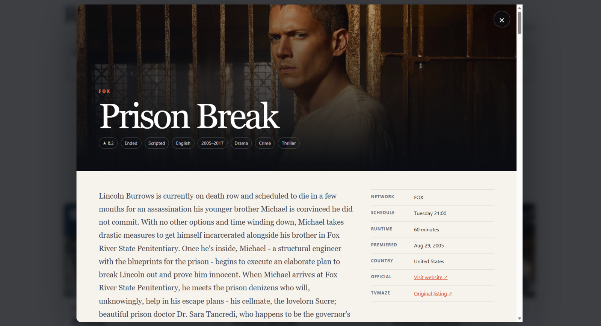
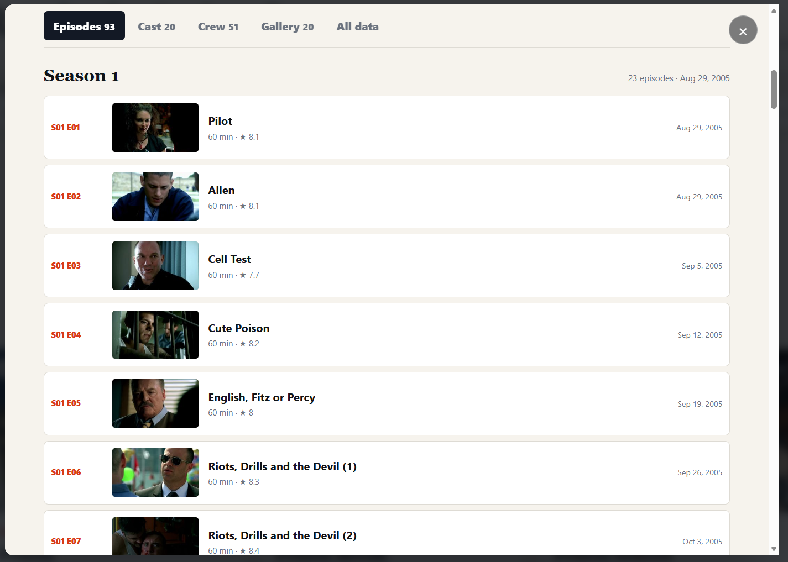
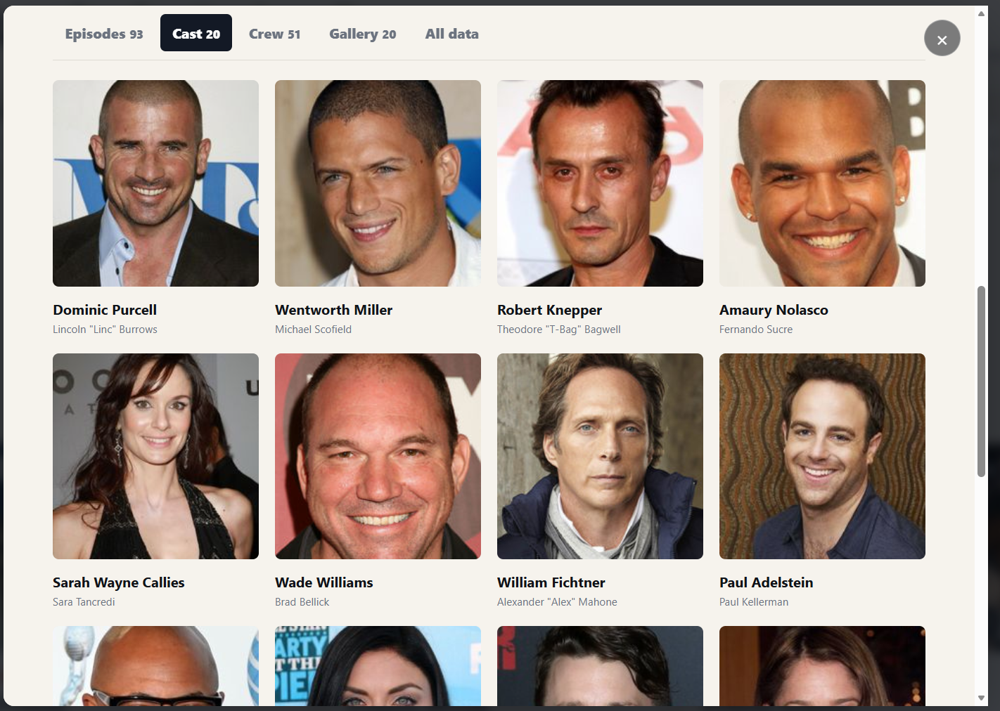
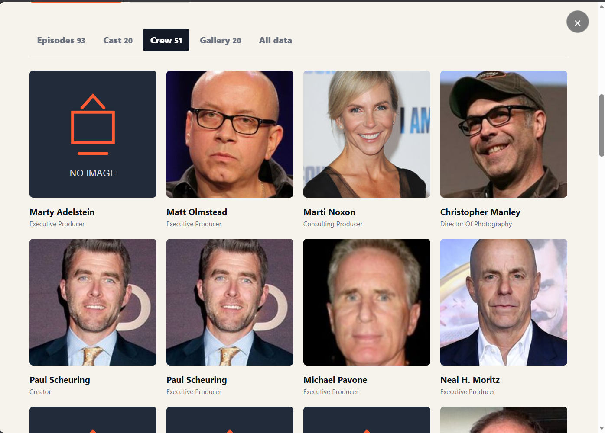
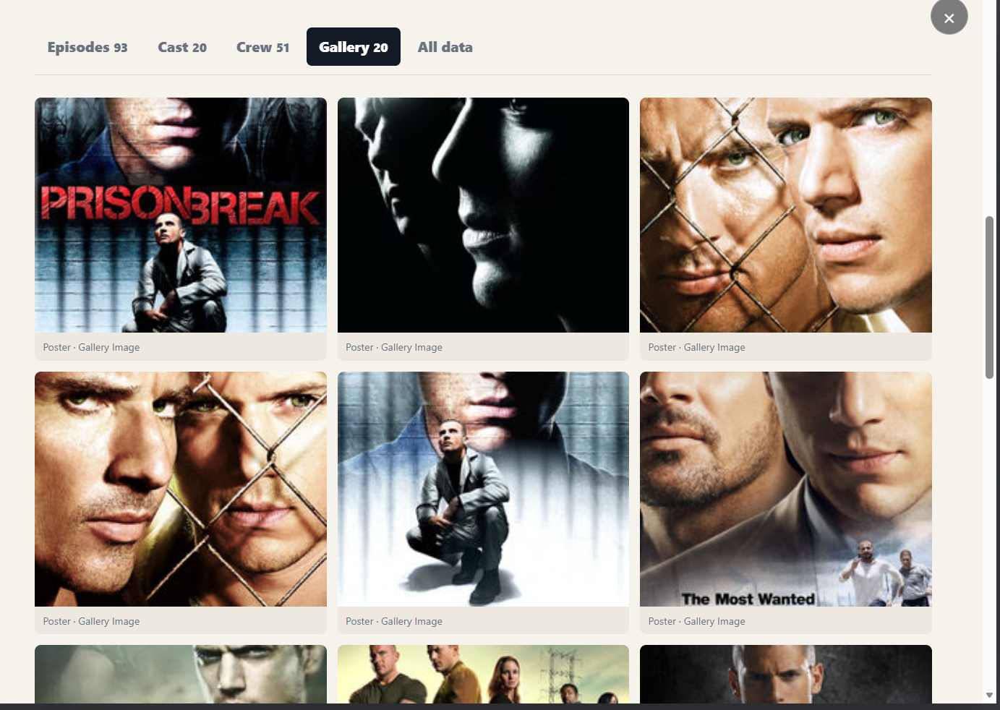
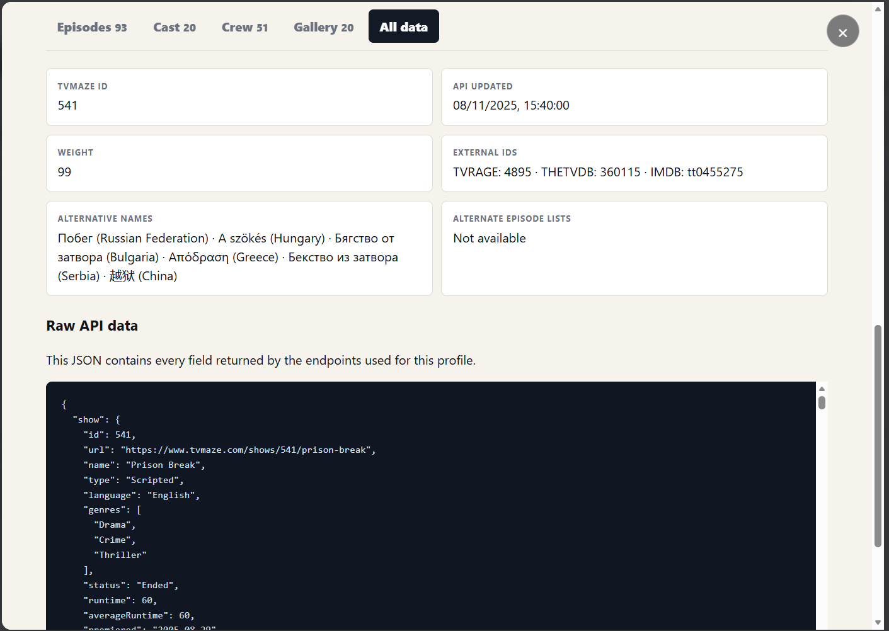
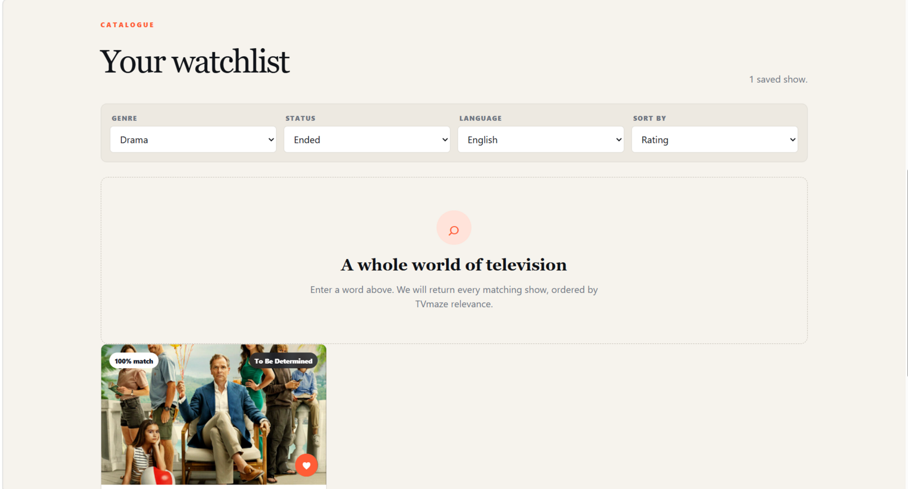

# Scene — TVmaze API Explorer

Scene is a responsive, dependency-free web application built on the public [TVmaze REST API](https://www.tvmaze.com/api). A search word returns related shows; each result opens a complete profile containing episodes, seasons, cast, crew, images, alternative titles and API metadata.



## Purpose

The objective was to demonstrate a complete API-driven user flow: accept an open-ended query, request and combine remote resources, handle incomplete or failed responses, and turn JSON data into an interface that supports discovery rather than merely printing an API response.

## Data collection

The app sends the user's search term to TVmaze's public search endpoint. When a show is opened, it requests the show record plus episodes (including specials), seasons, cast, crew, alternative names, images and alternative episode lists. Detail requests run concurrently with `Promise.allSettled`, so an optional endpoint can fail without hiding the rest of the profile.

The project does not scrape TVmaze HTML and does not require an API key. It uses only data returned by the documented REST API.

## Data persistence and how data is saved

There is no database: TVmaze remains the source of truth, so only small browser-local state is stored.

- `localStorage` saves the user's watchlist and five recent searches across browser sessions.
- `sessionStorage` caches API responses for 30 minutes to reduce repeated requests and provide a cached fallback during temporary network errors.
- The application has no custom database or backend because TVmaze is the authoritative data source and the only persistent user state is small, browser-local preference data.

## User interaction

The user can type a word, select a live suggestion or submit the full search. Results can be filtered by genre, status and language and sorted four ways. A card opens a tabbed detail dialog with the combined resources and raw JSON. Shows can be added to a persistent watchlist; searches and show IDs are encoded in the URL hash so a state can be bookmarked or shared. Pressing `/` focuses the search box.

## Feature demonstration

The live-suggestion screenshot above shows the first stage of the search flow. The following screenshots were captured against the public TVmaze API during final manual verification.

| Search results | Filters and sorting |
|---|---|
|  |  |
| A submitted query produces scored show cards with status, rating, metadata and watchlist controls. | Genre, status and language filters can be combined and the remaining results reordered by rating. |

| Show overview | Seasons and episodes |
|---|---|
|  |  |
| The overview combines the show image, summary, rating, genres, dates, network, schedule and external links. | Episodes are grouped by season and include numbers, images, runtime, rating and air date. |

| Cast | Crew |
|---|---|
|  |  |
| Cast data pairs performers with their character names. | Crew data exposes creators, producers, cinematographers and other production roles, with explicit image fallbacks. |

| Gallery | API metadata and raw JSON |
|---|---|
|  |  |
| The gallery displays the available poster and background resources. | The All data tab exposes IDs, update information, alternative names, alternative episode lists and the complete combined JSON response. |

| Persistent watchlist |
|---|
|  |
| Saved shows appear in a dedicated watchlist backed by browser `localStorage`, so the selection survives a refresh. |

## API endpoints

| Purpose | Endpoint |
|---|---|
| Search | `/search/shows?q=:query` |
| Show | `/shows/:id` |
| Episodes | `/shows/:id/episodes?specials=1` |
| Seasons | `/shows/:id/seasons` |
| Cast | `/shows/:id/cast` |
| Crew | `/shows/:id/crew` |
| Alternative names | `/shows/:id/akas` |
| Gallery | `/shows/:id/images` |
| Alternative episode lists | `/shows/:id/alternatelists` |

## Setup

Requirements: a modern browser, Python 3 (for the local static server) and an internet connection to `api.tvmaze.com`. No API key, package installation or build step is required.

```powershell
cd 03-tvmaze-explorer
py -m http.server 5500
```

Open [http://localhost:5500](http://localhost:5500). Keep the terminal open while using the app and stop the server with `Ctrl+C`. If port 5500 is busy, choose another port, for example `py -m http.server 8080`.

Opening `index.html` directly is not recommended; a local HTTP server gives browser requests a consistent origin.

## Tests

With Node.js installed:

```powershell
npm test
```

The tests are static source-level checks: they read the HTML, CSS and JavaScript files and validate DOM contracts, endpoint coverage, security safeguards, responsive styles, advanced features and the suggestion-overflow fix. They do not call the live API. Result after the follow-up audit: **6/6 checks passed**.

## Security and resilience

- API summaries are converted to text instead of injected as untrusted HTML.
- Dynamic text and attributes are escaped and external URLs are validated.
- New-tab links use `noopener noreferrer`.
- superseded searches are cancelled with `AbortController`;
- cached data can be used during a network failure;
- missing images, dates, ratings and optional sections have explicit fallbacks;
- the suggestion layer is positioned above the following section and scrolls internally on long result lists.

## Learning

I learned how to read API documentation and translate multiple endpoints into one coherent data model. I practiced asynchronous JavaScript, request cancellation, concurrent requests, partial-failure handling, caching and URL-based application state. I also learned that robust API interfaces must represent loading, empty, cached, partial and error states—not only the successful response.

### Challenge and how I approached it

During manual testing I noticed that the live suggestion list was cut off where the hero section ended, so the first interaction a user sees looked broken. The cause was the hero clipping its overflow together with the stacking order of the decorative layer. I let the hero overflow, kept the decorative layer from capturing clicks, gave the suggestions their own layer and made long lists scroll inside a fixed height. I then added an automated check so that the fix cannot be undone silently.

## Limitations and assistance

Limitations:

- the app requires TVmaze and a working internet connection for uncached searches;
- TVmaze availability, rate limits and field completeness are outside this project's control;
- search endpoint relevance is determined by TVmaze, not by the app;
- the 30-minute cache belongs to one browser tab and is not an offline database;
- watchlist entries are local to one browser profile and are not synchronized;
- there is no service worker/PWA installation and no automated live-API end-to-end test;
- some optional resources may be absent for a show, so profiles can be partially complete.

To the best of my knowledge no tutorial code or other external code was copied into this project beyond the AI assistance described here.

AI assistance (ChatGPT/Codex) was used for API explanation, interface iteration, debugging, code review and documentation structure. I selected the features, ran and evaluated the app, reported interface problems, reviewed the fixes and verified the final search behavior. See [`AUDIT.md`](AUDIT.md) for the audit trail.

## Architecture

- `index.html` — semantic structure, templates and accessible controls;
- `styles.css` — design system, responsive layout and interaction states;
- `app.js` — API client, cache, state, filters and rendering;
- `tests/` — automated source-level checks;
- `PROJECT_REPORT.md` — deeper design decisions and future work.

Data and images are provided by TVmaze. This educational project is not affiliated with TVmaze.
